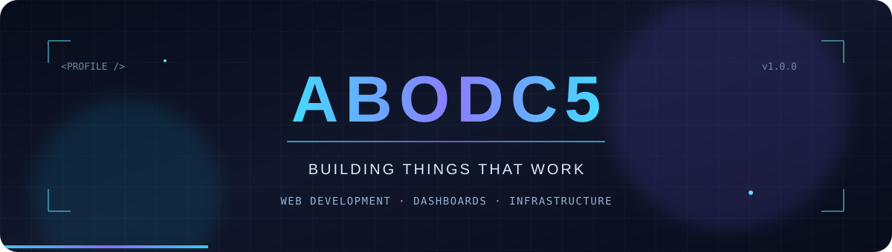

 

### Hey, I'm ABODC5 👋

**Developer focused on practical software, clean interfaces, and reliable systems.**

I build web applications, dashboards, and tools — and I enjoy working on game-server infrastructure and automation.

 

---

### About Me

- Building responsive web apps and data-driven dashboards.
- Working with backend APIs, databases, and integrations.
- Interested in automation, infrastructure, and server performance.
- Focused on useful features, good UX, and maintainable code.

### Tech & Tools

### What I'm Building

| Area | Focus |
| :-- | :-- |
| **Web Development** | Practical interfaces and interactive applications |
| **Dashboards** | Monitoring, reporting, and data management |
| **Backend Systems** | APIs, databases, and service integrations |
| **Game Infrastructure** | Minecraft servers, automation, and performance |

### GitHub Activity

### Contact

- **Discord:** `abodc5`
- **GitHub:** [github.com/ABODC5](https://github.com/ABODC5)

---

Build thoughtfully. Keep improving.

